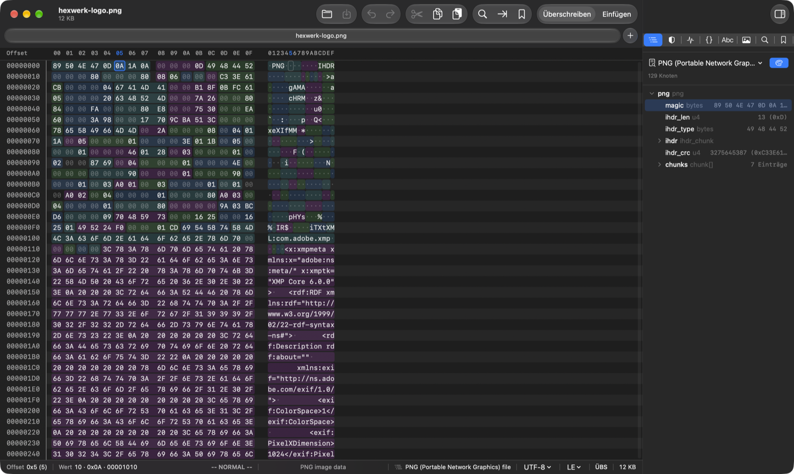
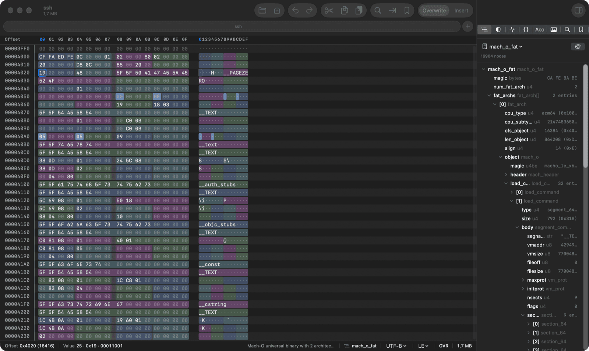
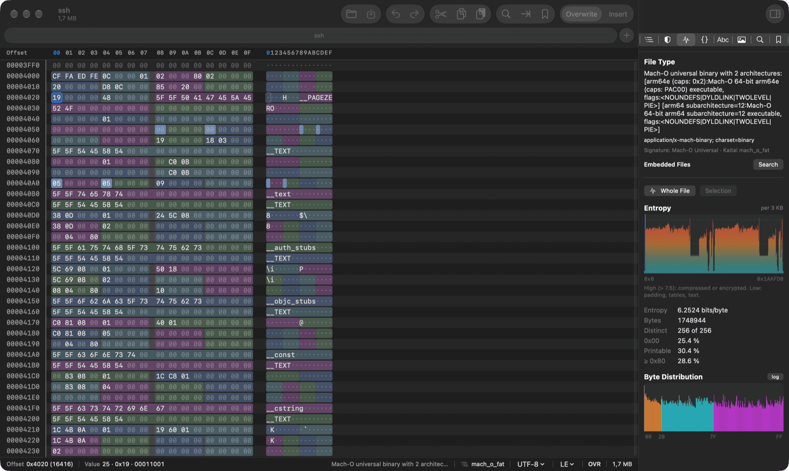

<p align="center"></p>

# hexwerk

[](https://scorecard.dev/viewer/?uri=github.com/thomas-schreck/hexwerk)
[](https://www.bestpractices.dev/projects/16417)

A native macOS hex editor for reverse engineering and malware analysis —
with Kaitai Struct, YARA-X, JavaScript scripting and a full command line tool.



> **Status:** early, single-maintainer project. See the [open issues](https://github.com/thomas-schreck/hexwerk/issues)
> for known problems — hexwerk is not yet hardened against all hostile input.

## Features

**Editing**
- Opens large files via memory mapping; piece-table editing with undo/redo
- Overwrite and insert mode, hex and text columns (ASCII, Latin-1, UTF-8), Vim key bindings
- Multiple files as tabs, bookmarks, go to offset/value, fill, copy as C/Python/Swift/Base64/hex
- Navigation history (Back ⌃⌘← / Forward ⌃⌘→ over jumps), follow pointer from the
  inspector or structure tree, select parent structure (⌃⌘↑), step the selection by its
  own length (⌥⌘← / ⌥⌘→), mark selection start/end (⌃⌘B / ⌃⌘E)
- Search for hex (with `??` for any byte and `4?`/`?D` for one nibble), text, numbers or regex;
  turn all search, YARA or strings hits into bookmarks in one step
- Data inspector with editable values (integers, floats, times, GUID, LEB128, text)
- Intel HEX and Motorola S-Record import with write-back
- Base address per file (e.g. a firmware's load address): addresses in the offset column,
  go to, hit lists and the script API; display only, the file is never changed

**Analysis**
- **Kaitai Struct**: parses files with `.ksy` schemas, structure tree linked to colored byte ranges, lazy arrays for millions of elements; format auto-detection
- **YARA-X** rule scanning with hits in the hex view
- Kaitai parsing, YARA-X scans, scripts and libmagic run sandboxed (no network, no file
  access): in the app in a helper process, in the CLI in a child process of its own. A
  malformed sample that crashes a parser takes down that process, not the app with your
  unsaved edits or the CLI
- File type detection (libmagic + signatures) and embedded-file search
- Entropy profile and byte histogram, image view (9 pixel formats)
- Strings finder (ASCII, UTF-8, UTF-16), regex search
- 45 checksums and hashes in one pass (CRC family, Adler, Fletcher, FNV, xxHash, Murmur3, MD2/4/5, SHA-1/2/3, BLAKE2/3, RIPEMD-160, SM3, …),
  optionally skipping ranges such as the checksum field itself
- Binary diff that detects inserted and deleted bytes; take one or all differences over
  from the other file (undoable), the diff follows your edits
- Number calculator

**Automation**
- JavaScript scripting (JavaScriptCore) with an `hw` API on the open document, run with a time limit and applied as one undo step;
  scripts can mark findings with `hw.bookmark(off, len, name)` and `hw.highlight(off, len, color)`
- `hexwerk` command line tool for everything above

### A short tour

**Structure.** Pick a Kaitai format (or let hexwerk detect it) and every field
gets a color in the hex view; clicking a byte selects its field in the tree.
Here a universal Mach-O binary, from the fat header down into the arm64 slice:



**Analysis.** File type from libmagic and signatures, embedded-file search,
entropy profile and byte distribution for the whole file or a selection:



**Command line.** The same engine without the GUI, for scripts and pipelines:

```console
$ hexwerk type ssh
Type       Mach-O universal binary with 2 architectures: [arm64e …] [arm64 …]
MIME       application/x-mach-binary; charset=binary
Signature  Mach-O Universal → Kaitai format mach_o_fat

$ hexwerk parse --format mach_o_fat ssh | head -6
mach_o_fat : mach_o_fat  [0x0, 48 B]
  magic : bytes = CA FE BA BE  [0x0, 4 B]
  num_fat_arch : u4 = 2  [0x4, 4 B]
  fat_archs : fat_arch[] = 2 entries  [0x8, 40 B]
    [0] : fat_arch  [0x8, 20 B]
      cpu_type : u4 = arm64 (0x100000C)  [0x8, 4 B]
```

## Requirements

- macOS 26 or later on Apple silicon
- Swift 6 toolchain (Command Line Tools or Xcode)
- Homebrew packages `yara-x` and `libmagic` (linked statically; set
  `HOMEBREW_PREFIX` if Homebrew is not in its default location)

Notes:
- The static libraries come from Homebrew's bottle for the build machine. A
  build on macOS 27 links bottles made for macOS 27 and prints linker warnings
  about the newer object files; it runs on the build machine, but builds meant
  for macOS 26 should be made on macOS 26 — release builds come from the
  GitHub runner, which uses macOS 26.
- `Package.swift` uses `unsafeFlags` to link the static libraries, so the
  package cannot be used as a dependency of another SwiftPM package. hexwerk
  is an app and a CLI, so this is intended.

## Download

Via Homebrew ([own tap](https://github.com/thomas-schreck/homebrew-tap), Apple silicon):

```sh
brew tap thomas-schreck/tap && brew trust thomas-schreck/tap
brew install --cask thomas-schreck/tap/hexwerk   # app
brew install thomas-schreck/tap/hexwerk          # CLI
```

Or download the app and CLI from the
[releases page](https://github.com/thomas-schreck/hexwerk/releases). The app is
not notarized: on first start allow it under *System Settings → Privacy &
Security → Open Anyway*.

## Build and install

```sh
brew install yara-x libmagic
git clone https://github.com/thomas-schreck/hexwerk.git
cd hexwerk
make install-app     # builds dist/hexwerk.app and copies it to /Applications
make cli             # installs the hexwerk command to ~/.local/bin (PREFIX=… to change)
make formats         # downloads the Kaitai Struct format collection
```

Run the tests with `swift build && swift test`.

## Command line

```sh
hexwerk open firmware.bin             # open in the app
hexwerk dump file.bin --offset 0x100 --length 64   # hexdump -C style
hexwerk type sample.exe               # file type + embedded files
hexwerk parse --format png image.png  # Kaitai Struct, also --ksy my.ksy
hexwerk yara rules.yar sample.bin
hexwerk hash --algo common file.bin
hexwerk hash --algo crc32 --exclude 0x1fc:4 fw.bin   # skip the CRC field
hexwerk diff old.bin new.bin
hexwerk strings -n 6 sample.bin
hexwerk find sample.bin "4D 5A ?? 0?"   # ?? any byte, 0? / ?D one nibble
hexwerk convert firmware.hex firmware.bin
hexwerk script patch.js file.bin --write  # without --write: dry run
```

`hexwerk --help` lists all commands: `dump`, `inspect`, `find`, `diff`, `hash`,
`parse`, `yara`, `entropy`, `export`, `script`, `type`, `strings`,
`convert`, `open`.

`hexwerk script` prints the script's output first, then one line per
`hw.bookmark` / `hw.highlight` call: kind, offset, length, name or color
(`bookmark   0x00000010  4  header`). Scripts that mark nothing print exactly
their own output.

Shell completions (zsh, bash, fish; `parse --format` completes the IDs of the
format collection) and a man page are installed by the Homebrew formula and
included in the CLI archive under `completions/` and `man/`. For a source build,
`hexwerk --generate-completion-script zsh` prints the script.

## Where hexwerk stores data

| What | Where |
|---|---|
| Kaitai format collection (`make formats`) | `~/.config/hexwerk/formats` |
| Own and translated `.ksy` files (override the collection) | `~/.config/hexwerk/ksy` |
| YARA rules and scripts (suggested folders) | `~/.config/hexwerk/yara`, `~/.config/hexwerk/scripts` |
| Settings | `~/.config/hexwerk/settings.json` |
| Per-file state (bookmarks, format, position) | `<file>.hexwerk` next to the file once it has bookmarks, otherwise `~/.config/hexwerk/projects` |

`$XDG_CONFIG_HOME` is respected.

The app makes one kind of network request: at most once a day it asks the
GitHub releases API (`api.github.com/repos/thomas-schreck/hexwerk/releases`)
for the newest release and shows "Update Available" in the hexwerk menu when it is
newer (a beta also hears of newer betas, a stable version only of stable
releases). The request carries only a `hexwerk/<version>` User-Agent, nothing is
downloaded. Turn it off with *hexwerk > Check for Updates Automatically*
(`"checkForUpdates": false` in `settings.json`); builds without a version (`dev`)
never check. The CLI and the parser helper make no network connections; the
sandboxed processes that parse file content could not make any (see
[SECURITY.md](SECURITY.md#sandboxing)).

## Language

The app and the CLI speak **English and German** and follow the system
language. To choose explicitly:

- App: *hexwerk → Language* (takes effect after a restart), stored as
  `"language": "en" | "de"` in `settings.json`
- CLI: `HEXWERK_LANG=en hexwerk …` (otherwise `LC_ALL`, `LC_MESSAGES`, `LANG`)

## Contributing

Every change starts with an issue and arrives as a pull request — see
[GOVERNANCE.md](GOVERNANCE.md) and [CONTRIBUTING.md](CONTRIBUTING.md).
Report security problems privately as described in [SECURITY.md](SECURITY.md).

## License

hexwerk is released under the [MIT License](LICENSE). It statically links
YARA-X, libmagic and their dependencies; their licenses are reproduced in
[THIRD_PARTY_NOTICES.md](THIRD_PARTY_NOTICES.md).
